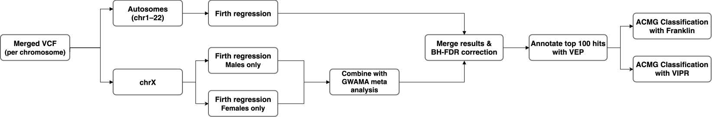

# GRAFX: Genetic Risk Association using Firth’s regression, including chromosome X

Firth penalised logistic regression across the autosomes and the X chromosome,
pooled multiple testing correction, and functional annotation of the top hits.



## Scripts

| File | Description |
| --- | --- |
| `merge_UV_LR.pbs` | Merges the unvaccinated cohorts and writes the per-chromosome VCFs |
| `firthLR_perchr.R` | Firth regression for one autosome |
| `firthLR_chrX_males.R` | Firth regression on non-PAR chrX, males |
| `firthLR_chrX_females.R` | Firth regression on non-PAR chrX, females |
| `prep_GWAMA.R` | Writes the per-sex GWAMA input files and the file list |
| `extract_GWAMA.R` | Extracts the sex-differentiated results from the GWAMA output |
| `pooled_bh_correction.R` | Pooled BH correction across chr1-22 and chrX, writes the top 100 |
| `plot_results.R` | QQ and Manhattan plots |
| `top100_to_vep.R` | Converts the top 100 to VEP input |
| `merge_top100_vep.R` | Joins the VEP annotation back to the association results |
| `diagnose_variant.R` | Localises the source of an implausible odds ratio for one variant |

## Software

| Tool | Version |
| --- | --- |
| bcftools | 1.19 |
| PLINK 2 | 2.00a |
| PLINK 1.9 | 1.90 |
| R | 4.6.0 |
| GWAMA | 2.2.2 |
| Ensembl VEP | release 116 (June 2026) |

GWAMA is available from https://genomics.ut.ee/en/tools.

## Metadata

All of the R scripts read a tab-separated metadata file with these columns:

```
SampleID  phenotype  age  sex  GBR  YRI  NAMA  ASIAN
```

`GBR`, `YRI`, `NAMA` and `ASIAN` are the global ancestry proportions from
ADMIXTURE. `ASIAN` is the reference category and is not fitted. Sex is coded
1 for male and 0 for female.

| File | Samples |
| --- | --- |
| `meta_data.txt` | all |
| `meta_males.txt` | males |
| `meta_females.txt` | females |
| `PRF_meta_data.txt` | PRF substudy |

## 1. Input preparation

`merge_UV_LR.pbs` produces the per-chromosome VCFs in `../CVD_vcfs/per_chr/`.

Create the sample list once. The sample order is the same for every autosome,
and it sets the column order of every genotype table below.

```bash
bcftools query -l ../CVD_vcfs/per_chr/chr22.vcf.gz > samples.txt
```

Create a genotype table per chromosome:

```bash
for i in $(seq 1 22); do
    bcftools query -f '%CHROM:%POS:%REF:%ALT[\t%GT]\n' \
        ../CVD_vcfs/per_chr/chr${i}.vcf.gz > chr${i}_gt.tsv
done
```

## 2. Autosomes

```bash
for i in $(seq 1 22); do
    Rscript firthLR_perchr.R chr${i}
done
```

Writes `chr{1-22}_firth_results.tsv`. The `p_BH` column is a per-chromosome
correction and is overwritten with the pooled correction in step 4. Use the
pooled value.

## 3. Chromosome X

Two separate branches. The QC branch establishes the non-PAR boundaries and
checks sex assignment; the analysis branch produces the genotype tables that
the regression actually uses. Nothing from the PLINK filesets feeds the
association.

### QC branch

PLINK takes sex from the `.fam`, which a VCF does not supply, so write a sex
file from the metadata first. PLINK codes male as 1 and female as 2:

```bash
awk -F'\t' 'NR>1 {print "0\t"$1"\t"($4==1 ? 1 : 2)}' meta_data.txt > sex_update.txt
```

Convert to PLINK, apply the sex assignment, split off the pseudoautosomal
regions and keep only non-PAR X:

```bash
plink2 --vcf ../CVD_vcfs/per_chr/chrX.vcf.gz \
       --update-sex sex_update.txt \
       --split-par b38 \
       --chr X \
       --set-all-var-ids '@:#' \
       --new-id-max-allele-len 60 \
       --rm-dup force-first \
       --make-bed --out chrX_nonpar
```

Sex check on a pruned subset, flagging samples whose genotypic sex disagrees
with the recorded sex:

```bash
plink2 --bfile chrX_nonpar --maf 0.05 --indep-pairwise 200 50 0.2 --out xprune
plink --bfile chrX_nonpar --extract xprune.prune.in --check-sex --out sexcheck
awk 'NR==1 || $5=="PROBLEM"' sexcheck.sexcheck
```

Per-sample heterozygosity across the non-PAR region. The boundaries are the
GRCh38 values used by `--split-par b38`, 2781479 and 155701383:

```bash
bcftools view -r chrX:2781480-155701382 ../CVD_vcfs/per_chr/chrX.vcf.gz -Ou \
  | bcftools stats -s - | grep '^PSC' \
  | awk 'BEGIN{print "sample\tnHom\tnHet"} {print $3"\t"($5+$7)"\t"$6}' \
  | sort -t$'\t' -k3,3n \
  > x_nonpar_het.tsv
```

Collect the flagged samples and remove them, before counting male
heterozygous calls:

```bash
awk 'NR>1 && $5=="PROBLEM" {print $1"\t"$2}' sexcheck.sexcheck > remove_sexcheck.txt
plink2 --bfile chrX_nonpar --remove remove_sexcheck.txt --make-bed --out chrX_clean
```

Sex keep-lists in PLINK format, FID 0 and IID from the metadata:

```bash
awk -F'\t' 'NR>1 && $4==1 {print "0\t"$1}' meta_data.txt \
  | grep -vxFf <(cut -f2 remove_sexcheck.txt) > males.txt
awk -F'\t' 'NR>1 && $4==0 {print "0\t"$1}' meta_data.txt \
  | grep -vxFf <(cut -f2 remove_sexcheck.txt) > females.txt
```

Confirm no heterozygous male calls remain. A correctly called non-PAR male
genotype is hemizygous, so `HET` should be zero:

```bash
plink2 --bfile chrX_clean --keep males.txt --geno-counts --out male_gtcounts
awk 'NR>1 {hapref+=$9; hapalt+=$10; het+=$7; homref+=$6}
     END{print "HAP_REF:"hapref" HAP_ALT:"hapalt" HET:"het" HOM_REF:"homref}' \
    male_gtcounts.gcount
```

### Analysis branch

Sample lists for bcftools are plain IIDs, one per line, and are not the same
format as `males.txt` and `females.txt` above. The samples flagged at the sex
check are still present in the VCF, so they have to be excluded here as well:

```bash
awk -F'\t' 'NR>1 && $4==1 {print $1}' meta_data.txt \
  | grep -vxFf <(cut -f2 remove_sexcheck.txt) > male_ids.txt
awk -F'\t' 'NR>1 && $4==0 {print $1}' meta_data.txt \
  | grep -vxFf <(cut -f2 remove_sexcheck.txt) > female_ids.txt
wc -l male_ids.txt female_ids.txt
```

Subset the non-PAR region by sex:

```bash
bcftools view -r chrX:2781480-155701382 -S male_ids.txt \
    ../CVD_vcfs/per_chr/chrX.vcf.gz -Oz -o chrX_male.vcf.gz
bcftools index chrX_male.vcf.gz

bcftools view -r chrX:2781480-155701382 -S female_ids.txt \
    ../CVD_vcfs/per_chr/chrX.vcf.gz -Oz -o chrX_female.vcf.gz
bcftools index chrX_female.vcf.gz
```

Genotype tables and matching sample lists:

```bash
bcftools query -f '%CHROM:%POS:%REF:%ALT[\t%GT]\n' chrX_male.vcf.gz   > chrX_male_gt.tsv
bcftools query -f '%CHROM:%POS:%REF:%ALT[\t%GT]\n' chrX_female.vcf.gz > chrX_female_gt.tsv

bcftools query -l chrX_male.vcf.gz   > samples_male.txt
bcftools query -l chrX_female.vcf.gz > samples_female.txt
```

Firth regression per sex, then the meta-analysis:

```bash
Rscript firthLR_chrX_males.R
Rscript firthLR_chrX_females.R
Rscript prep_GWAMA.R
GWAMA --filelist gwama.in --output chrX_meta --sex --indel_alleles
Rscript extract_GWAMA.R
```

`gwama.in` lists the input files by relative name, so GWAMA must be run from
the directory holding `chrX_male.gwama.txt` and `chrX_female.gwama.txt`.
`--sex` is what produces the gender-differentiated and heterogeneity p-values
that `extract_GWAMA.R` reads from `chrX_meta.out`.

## 4. Pooled correction and plots

```bash
Rscript pooled_bh_correction.R
Rscript plot_results.R
```

Run in this order. `pooled_bh_correction.R` rewrites `p_BH` in place in all 23
input files with no backup, and `plot_results.R` reads that column.

Outputs are `top100_hits_pooled_BH.tsv`, `plots/qq_plot.png` and
`plots/manhattan_plot.png`. The Manhattan plot covers the autosomes only.

If the plot text does not render as Arial, install `extrafont`, run
`font_import()` once, and set `BASE_FAMILY <- "Arial"` at the top of
`plot_results.R`.

## 5. Annotation

```bash
Rscript top100_to_vep.R
```

Submit `top100_for_vep.txt` to the Ensembl VEP web interface, release 116:
https://jun2026.archive.ensembl.org/Tools/VEP

| Setting | Value |
| --- | --- |
| Species | Homo sapiens (GRCh38.p14) |
| Transcript database | Ensembl/GENCODE |
| Identifiers | Gene symbol, transcript version |
| Variants and frequency data | PubMed IDs, 1000 Genomes continental allele frequencies, gnomAD (genomes) allele frequencies |
| Pathogenicity predictions | SIFT, PolyPhen |
| Restrict results | One selected consequence per variant |

Save the output as `vep_annotated_top100.txt`, then:

```bash
Rscript merge_top100_vep.R
```

`top100_annotated.tsv` carries the consequence, gene and gnomAD genomes
frequencies. The SIFT, PolyPhen, 1000 Genomes and PubMed fields stay in the
VEP output file and were used directly from there.

The annotated variants were then classified under ACMG criteria in two ways,
with Franklin (https://franklin.genoox.com/clinical-db/home) and with VIPR
(https://github.com/chenekitching/VIPR).

## 6. Variant diagnostics

Used in the PRF substudy to establish whether an implausible odds ratio came
from a covariate, from the genotype vector itself, or from quasi-separation.
Set `SNP` and `gt_file` at the top of the script, then:

```bash
Rscript diagnose_variant.R
```

Together these steps produce the genome-wide association results, the pooled
FDR-corrected top 100, and their functional annotation.
