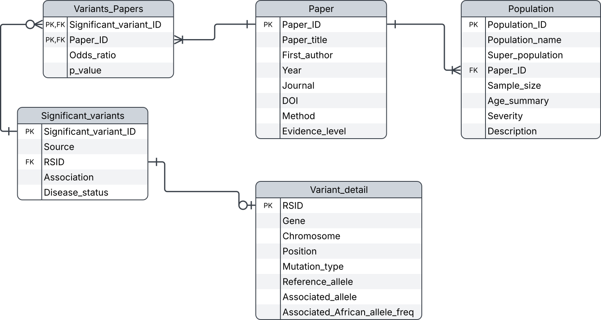

# COVID-19 risk variant database

A curated SQLite database of host genetic variants reported as associated with
COVID-19 outcomes, and the comparison of those variants with the association
results from this cohort.

Adapted from the COHG-SA database (Barmania et al., 2022) and extended by a
systematic PubMed search. Variants are keyed on rsID and linked to the papers
reporting them, so a single variant may carry several odds ratios. One odds
ratio is selected per variant at export, ranked by evidence level, then sample
size, then p-value.

## Scripts

| File | Description |
| --- | --- |
| `export_published_variants.sql` | Selects one odds ratio per variant and writes the literature variant set |
| `add_firth_results.R` | Matches the literature variants to the cohort association results and tests directional concordance |

## Database



| Table | Key | Fields |
| --- | --- | --- |
| `Variant_detail` | `RSID` | `Gene`, `Chromosome`, `Position`, `Mutation_type`, `Reference_allele`, `Associated_allele`, `Associated_African_allele_freq` |
| `Significant_variants` | `Significant_variant_ID` | `Source`, `RSID`, `Association`, `Disease_status` |
| `Variants_Papers` | `Significant_variant_ID`, `Paper_ID` | `Odds_ratio`, `p_value` |
| `Paper` | `Paper_ID` | `Paper_title`, `First_author`, `Year`, `Journal`, `DOI`, `Method`, `Evidence_level` |
| `Population` | `Population_ID` | `Population_name`, `Super_population`, `Paper_ID`, `Sample_size`, `Age_summary`, `Severity`, `Description` |

The database can be viewed interactively in
[DB Browser for SQLite](https://sqlitebrowser.org/), or from the command line:

```bash
sqlite3 covid_variants.db ".tables"
sqlite3 covid_variants.db ".schema Variant_detail"
```

## Exporting the variant set

```bash
sqlite3 -header -separator $'\t' covid_variants.db \
  < export_published_variants.sql > published_risk_variants.csv
```

The file is tab-separated despite the extension. The export yields 377 variants.

## Comparison with the cohort association results

```bash
Rscript add_firth_results.R
```

The script reads `published_risk_variants.csv` together with the autosomal and
chromosome X association results in `../02_GRAFX`, matches variants on
chromosome and position, and orients each odds ratio to the associated allele.

| Output | Contents |
| --- | --- |
| `published_risk_variants_results.tsv` | All variants with the cohort odds ratio, p-value, within-set BH q-value and concordance flag |
| `not_concordant.tsv` | Variants where the cohort and published directions disagree |

Of the 377 variants, 342 were present in the cohort association results, and
240 of 318 variants with a reported direction (75.47%) were directionally
concordant.

The database and the comparison together establish which published COVID-19
risk variants replicate directionally in this admixed South African cohort.
