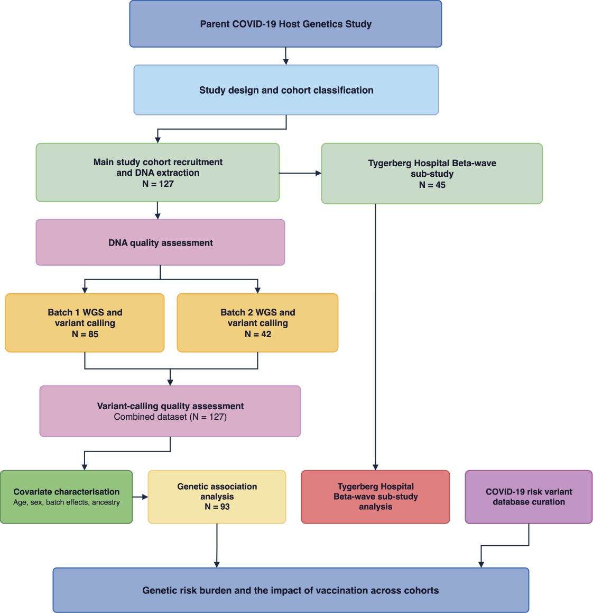

# The impact of vaccination in the presence of host genetic risk factors linked to COVID-19 severity

MSc Human Genetics thesis analysis code. A genetic association study of COVID-19 
severity in a South African population, using whole-genome sequencing data from
unvaccinated and vaccinated participants.

Participants were grouped into four cohorts by vaccination status and disease
outcome: unvaccinated highly exposed (UV-HE), unvaccinated mild disease (UV-MD),
unvaccinated severe disease (UV-SD) and vaccinated mild disease (V-MD).
The analysis covers variant calling and quality control, ancestry inference,
genetic association testing, and a comparison of genetic risk burden
between the vaccinated and unvaccinated cohorts.

## Repository structure

| Folder | Contents |
| --- | --- |
| `00_variant_calling_qc` | Variant calling and sample-level quality control |
| `01_ancestry` | Global ancestry inference and cohort ancestry comparison |
| `02_GRAFX` | Genetic association analysis and annotation of the top hits |
| `03_ld_analysis` | Linkage disequilibrium maps for the loci discussed in the thesis |
| `04_COVID_19_risk_variant_db` | Curated database of published COVID-19 risk variants |
| `05_genetic_risk_burden` | Genetic risk burden across cohorts and the impact of vaccination |

Each folder has its own README describing the scripts, the tools and versions
used, and the order in which the steps are run.

## Data availability

No individual-level genotype or phenotype data are included in this
repository. The scripts expect input files that are described in each folder's
README but not distributed here. Requests for access to the underlying data
should be directed to the TB and COVID-19 Host Genetics Group, Stellenbosch
University (dp3@sun.ac.za).
